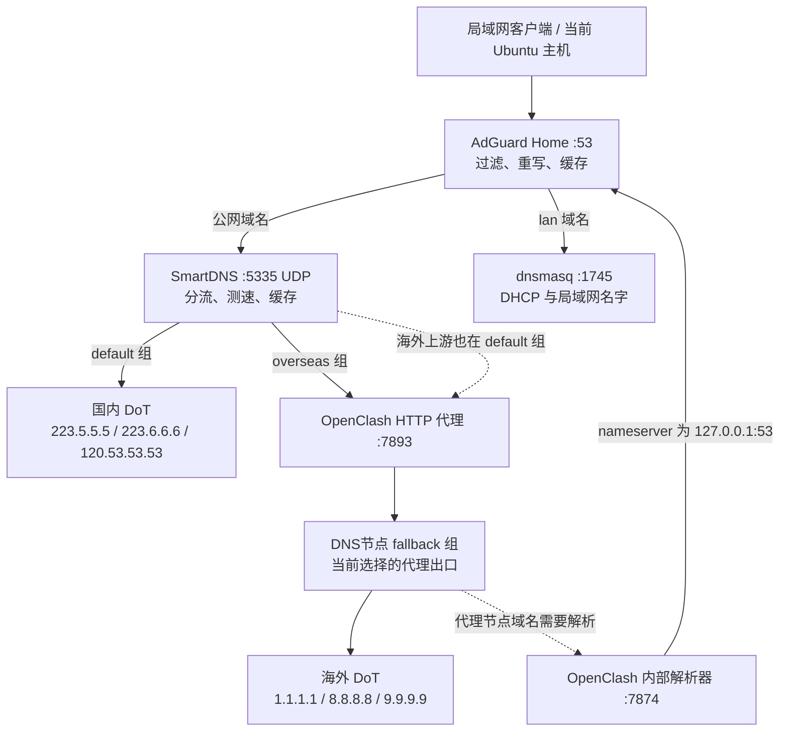

# iStoreOS DNS 链路与 GitHub 间歇解析失败调查

调查时间：2026-11-07 18:43–18:55，Asia/Shanghai。以下端口、版本、地址、耗时均为本次实测快照。生产配置未修改，服务未重启，未写 hosts，未切换生产代理节点。

本次 GitHub 解析失败已有路由器端证据：SmartDNS 返回 `SERVFAIL`，AdGuard Home 将失败缓存，后续请求继续命中失败缓存。对当前 AdGuard 二进制的隔离复现确认，过期缓存会先返回旧的 `SERVFAIL`，后台刷新后下一次查询才成功。这能解释先发生 SSH 解析失败、随后的 dig 又成功的现象。

首次上游失败的具体触发原因仍未确定。现存配置显示海外 DNS 共用代理出口、代理节点解析依赖业务 DNS；日志也记录了多个海外 DoT 连接同时超时，但不能把其他时刻的超时当成 17:22 那次失败的直接证据。

## 实际链路

图中的实线表示当前转发关系，虚线表示额外依赖。国内 DoT 是可以打破循环的分支，因此此图不表示已经证实持续死循环。



| 组件 | 实测职责与关键设置 | 取证位置 |
|---|---|---|
| 客户端 | `/etc/resolv.conf` 指向 `192.168.1.2`；NSS 为 `hosts: files dns` | 当前主机 `/etc/resolv.conf`、`/etc/nsswitch.conf` |
| AdGuard Home | TCP/UDP 53；公网上游为 `127.0.0.1:5335`；`lan` 转 `127.0.0.1:1745`；自有域名有 rewrites | router `/etc/AdGuardHome.yaml` |
| SmartDNS | IPv4 UDP 5335；海外上游经过 `http://127.0.0.1:7893`；强制 AAAA SOA；`serve-expired no` | `/etc/config/smartdns`、生成配置 `/var/etc/smartdns/smartdns.conf`、`/etc/smartdns/custom.conf` |
| OpenClash | 内部 DNS TCP/UDP 7874；`redir-host`；`nameserver/default-nameserver` 都是 `127.0.0.1`；未设置 `proxy-server-nameserver` | `/etc/openclash/TWG.yaml`，并以监听端口核实 |
| dnsmasq | DHCP 分发 DNS `192.168.1.2`；DNS 改在 1745；公网备用解析读取 WAN resolver | `/etc/config/dhcp`、`/var/etc/dnsmasq.conf.cfg01411c` |

版本取法：`AdGuardHome --version`、`/usr/sbin/smartdns -v`、`/etc/openclash/clash -v`。本次读到 AdGuard Home `v0.107.79`、SmartDNS `Release48.4`，Mihomo `alpha-ge183c58`。SmartDNS 通过自己的启动包装器加载运行环境，直接执行内部二进制出现的 ENOENT 不表示文件缺失或生产进程异常。

AdGuard 配置的 `upstream_mode: parallel` 不表示公网主上游有冗余：`#223.5.5.5` 是被注释的条目，`lan` 是条件转发，普通公网查询的主上游仍只有 SmartDNS。

OpenClash 的普通 UDP/53 DNS 劫持已关闭，未发现把客户端发往 AdGuard 的 DNS 统一重定向到 7874 的规则。TCP 业务透明代理使用 7892，UDP 业务通过 MARK `0x162`、路由表 354 送到 utun。配置中的 TUN `dns-hijack: 127.0.0.1:53` 作用于进入 TUN 的对应流量，不能据此把所有客户端 DNS 都画成先经过 OpenClash。

## GitHub 的直接证据

router 的 `/usr/bin/AdGuardHome/data/querylog.json` 中，`Answer` 是 DNS wire message 的 base64。解码后取 DNS header 的 RCODE，`2` 即 `SERVFAIL`。不能只按日志里的字符串判断是否解析成功。

以下时间由日志 UTC 加八小时得到，客户端均为当前主机 `192.168.1.6`，上游均为 `127.0.0.1:5335`，过滤结果为 `{}`。

| 本地时间，2026-11-07 | 查询 | 返回 | 缓存与耗时 |
|---|---|---|---|
| 17:22:48.399 | `ssh.github.com A` | SERVFAIL，0 个答案 | 非缓存；约 2.023 秒 |
| 17:22:55.026 | `ssh.github.com A` | SERVFAIL | `Cached: true`；约 0.123 毫秒 |
| 17:22:57.299 | `github.com A` | SERVFAIL | 非缓存；约 2.174 秒 |
| 17:23:06.000 | `api.github.com A` | SERVFAIL | 非缓存；约 2.269 秒 |
| 17:59:26.335 | `ssh.github.com A` | SERVFAIL | `Cached: true` |
| 18:22:17.016 | `ssh.github.com A` | SERVFAIL | `Cached: true` |
| 18:22:17.486 | `github.com A` | SERVFAIL | `Cached: true` |
| 18:22:17.898 | `github.com A` | NOERROR，1 个答案 | `Cached: true` |
| 18:22:18.333 | `ssh.github.com A` | NOERROR，1 个答案 | `Cached: true` |

这些采样证明近一小时后的请求仍拿到了失败缓存，不能据此声称上游在整个小时内持续不可用。过期缓存按请求触发刷新，后台刷新本身不会作为普通客户端查询完整出现在这份表里。

SSH 实际连接目标也已核实：`ssh -G git@github.com` 返回 `hostname ssh.github.com`、`port 443`。报错里出现 `ssh.github.com` 来自已有 SSH 配置。

当前主机 NSS 使用 `files dns`，resolver 地址直接是 `192.168.1.2`。路由器日志又明确记录给该客户端返回失败，因此 `resolvectl` 显示 `foreign` 不能作为 PVE 或 systemd-resolved 故障的依据。A 记录返回不同地域的 GitHub IP，本身也不能证明故障。

AAAA 在 SmartDNS 被主动抑制，本次实测返回 `NOERROR` 加 SOA、没有 IPv6 地址；它与 A 查询的 `SERVFAIL` 是两件事。本次有证据的失败发生在 A 查询。

## 同版本二进制隔离复现

只从 router 复制了 AdGuard 可执行文件到当前主机，未复制生产配置、密码或数据库。两个实例绑定本机高端口，使用可控的本机模拟 DNS 上游；它们唯一的缓存策略差异是 `cache_optimistic`。

| 步骤 | 开启 optimistic | 关闭 optimistic |
|---|---|---|
| 主上游返回 SERVFAIL，备用上游正常 | 返回 SERVFAIL；未调用备用上游 | 相同 |
| 主上游立即恢复，失败缓存尚未过 30 秒 | 仍返回缓存 SERVFAIL | 相同 |
| 第 33 秒，首次查询 | 立即返回旧 SERVFAIL，同时后台刷新 | 重新查询上游，直接返回正确 A |
| 再过 0.5 秒 | 返回正确 A | 返回正确 A |
| 主上游丢弃请求造成传输超时 | 本实验在关闭 optimistic 的实例另用新域名验证：约 2 秒后备用上游返回正确 A | 备用上游计数从 0 增到 1 |

生产对应设置是 `cache_enabled: true`、`cache_optimistic: true`、`cache_optimistic_answer_ttl: 30s`、`cache_optimistic_max_age: 1h`。上游主动回复 SERVFAIL 与上游不响应，会走不同的 fallback 路径。

该行为与当前版本依赖的 dnsproxy `v0.83.2` 源码一致：

- [AdGuard v0.107.79 的 go.mod](https://github.com/AdguardTeam/AdGuardHome/blob/v0.107.79/go.mod) 固定了依赖版本。
- [cache.go](https://github.com/AdguardTeam/dnsproxy/blob/v0.83.2/proxy/cache.go) 缓存 SERVFAIL，正常有效期上限 30 秒；optimistic 读取又允许过期条目在 max-age 内返回。
- [optimisticresolver.go](https://github.com/AdguardTeam/dnsproxy/blob/v0.83.2/proxy/optimisticresolver.go) 在后台重新查询并缓存返回值。
- [proxy.go](https://github.com/AdguardTeam/dnsproxy/blob/v0.83.2/proxy/proxy.go) 在 exchange 返回 error 时使用 fallback；本次单一主上游返回的 SERVFAIL message 没有作为 transport error 处理。

隔离复现脚本和结果保存在本机 `/var/tmp/llmux-dns-audit-20261107-3i7n6cm8/`，文件为 `reproduce_cache.py`、`results.jsonl`。实验进程均已退出；复制的二进制和实验工作目录已清理。重跑需先把同版本 AdGuard 二进制复制回该目录。

## 配置中的故障放大因素

**海外上游共用出口。** SmartDNS 的 Cloudflare、Google、Quad9 全部配置 `-proxy default-proxy`，OpenClash 又将这三个目标 IP 指向同一个 `DNS节点` fallback 组。单次连接经过当时所选的一个代理出口；三个公共 DNS 并没有提供三条独立的出站路径。OpenClash 日志在本地 18:09:59–18:10:10 记录了这三个目标 853 端口连接同时 `context deadline exceeded`。这证明共用出口存在同时失效的情况，但该时间不等于 GitHub 17:22 的初始失败时间。

**默认组混入海外上游。** 生成配置中，三个海外 `server-tls` 都有 `-group overseas`，均未带 `-exclude-default-group`。它们因此仍参加默认组查询；不能把当前 default 组简单理解成纯国内 DNS。[SmartDNS 官方分流说明](https://pymumu.github.io/smartdns/config/domain-forwarding/) 明确说明了排除默认组的用法。

**代理节点解析依赖业务 DNS。** OpenClash 的代理节点多使用域名，当前未配置独立的 `proxy-server-nameserver`，内部 DNS 又指回 AdGuard。结合默认组也包含代理上游，产生循环依赖分支。国内 DoT 分支仍可正常解析，因此尚未证实这是 17:22 的触发原因。当前抽测的三个节点域名，经 router 直问 `223.5.5.5` 均成功，约 5–8 毫秒，说明独立 bootstrap 路径具备实测基础；这不代表所有节点永远适用。[Mihomo 的相关配置说明](https://wiki.metacubex.one/config/dns/#proxy-server-nameserver) 可用于落实时核对。

**监控覆盖与运行时故障不一致。** `/root/scripts/dns-guard.py` 每 15 分钟主要抽检国内域名是否被解析到海外，不负责证明海外解析可用。已有每天 04:30 的 `dns_probe.py` 和每两小时节点专项测量，不能说完全没有真实 DoT 检测；但运行中的 `DNS节点` fallback 健康检查 URL 是 gstatic HTTPS，不能证明此刻代理后的 DoT 查询能完成。

**历史证据容易丢失。** SmartDNS 当前 `log-size/audit-size` 都是 64K，`log-num/audit-num` 都是 1。本次查询时文件已滚动到 18:50 之后，17:22 的 SmartDNS 细节不再保留；不能补写不存在的 TLS、节点切换或重连证据。

## 竞争性解释与证据边界

| 解释 | 本次判断 | 区分它的证据或下一项验证 |
|---|---|---|
| PVE / systemd-resolved 是此次错误来源 | 缺乏支持，无法解释路由器已记录的失败缓存 | NSS、resolv.conf、AdGuard 发给当前客户端的实际 RCODE |
| AdGuard 过滤规则拦了 GitHub | 本次记录不支持 | 过滤结果为空，实际 RCODE 为 SERVFAIL |
| SmartDNS 或其上游路径失败 | 已确认这一层向 AdGuard 返回失败，具体触发条件未确认 | 初始失败约 2 秒返回，Upstream 为 5335；下次需同窗保留 SmartDNS 与实际 DoT 探测 |
| AdGuard 失败缓存及 optimistic 延长症状 | 已确认 | 生产 Cached SERVFAIL 时间线、同版本隔离对照 |
| 代理 bootstrap 循环导致初始故障 | 配置风险成立，因果尚未证实 | 下次失败时同时查询节点域名的独立直连 resolver 与现有业务 resolver |
| 节点排序或 OpenClash 重启直接导致 GitHub 17:22 失败 | 尚未证实 | 已看到 18:02 的自动重启，但它晚于 17:22，不能拿它解释此前故障 |

## 后续调整顺序（尚未执行）

1. AdGuard 保留过滤和内网重写，先关闭 `cache_optimistic`，阻止过期失败结果继续先返回给客户端。隔离对照已验证这个参数对故障路径的作用；它不会解决上游本身失败，也不会消除正常的短时失败缓存。
2. 给 OpenClash 的代理节点配置经过验证的独立 bootstrap DNS，避免依赖业务 DNS。修改应落到实际生成配置的源头，并核对最终生成文件与运行时状态，防止定时任务或重启覆盖。
3. 在 SmartDNS 的 UCI 源配置中把海外上游排除出 default 组，保持国内与海外查询职责清楚；不要直接编辑 `/var/etc` 生成文件。
4. 核对海外 DNS 的出口容错：检测实际 DoT 查询、返回码和耗时，不能只看公共 DNS IP 数量或 gstatic 的 HTTPS 状态。备用路径也需要核对节点解析依赖及 DNS 结果与业务出口的地域匹配。
5. 监测同时观察 AdGuard 53、SmartDNS 5335、实际海外 DoT 查询，区分缓存命中和实际回源；保留足够的有界故障日志，覆盖下一次初始失败。

上述顺序针对已确认机制和配置依赖，不需要固定 GitHub IP 或改 Git 传输方式。此次调查没有把调整方案应用到生产。

## 本轮验证与可重查命令

18:43–18:54 的验证窗口内，GitHub 和 ssh.github.com 的系统 `getaddrinfo` 各连续 30 次成功；四个 DNS 端口分别查询 GitHub、SSH、API、Codeberg 的 A/AAAA，均收到 DNS 响应。53/5335 的 AAAA 被主动抑制，1745 读 WAN DNS，因此二者出现不同 IP 或 AAAA 结果不代表随机丢记录。

通过 router 的 `127.0.0.1:7893` 分别建立 HTTP CONNECT、完成校验证书的 TLS 握手、发送真实 DNS 报文，Cloudflare / Google / Quad9 当时均返回 NOERROR 和一个 A 答案，单次总耗时约 480 / 694 / 938 毫秒。GitHub SSH 返回成功认证提示；该服务不提供 shell，所以此命令退出码为 1 属于预期。

这些验证表明当时服务已恢复响应，不能用于声称间歇问题已修复。

```bash
# 当前监听关系、生成配置、IPv4 规则；输出前避免读取完整订阅和密钥配置
ssh router 'netstat -lntup | grep -E ":53 |:5335 |:7874 |:1745 |:7893 "'
ssh router 'cat /var/etc/smartdns/smartdns.conf'
ssh router 'iptables -t nat -S openclash_output; iptables -t mangle -S openclash_output'

# 客户端真正使用的 resolver 与 SSH 目标
cat /etc/resolv.conf
rg '^hosts:' /etc/nsswitch.conf
ssh -G git@github.com | rg '^(hostname|port) '

# 在一次失败附近立刻对比，保存完整 RCODE 与时间，而非只用 +short
dig @192.168.1.2 -p 53 ssh.github.com A +time=3 +tries=1
dig @192.168.1.2 -p 5335 ssh.github.com A +time=3 +tries=1
dig @192.168.1.2 -p 7874 ssh.github.com A +time=3 +tries=1

# GitHub 认证验证，不推送，不新增 host key
ssh -T -o BatchMode=yes -o ConnectTimeout=10 \
  -o StrictHostKeyChecking=yes -o UpdateHostKeys=no git@github.com
```

查询 AdGuard 历史时应在 router 本机按域名、有界时间窗流式筛选，只输出必要字段和解码后的 DNS header，避免把整份查询日志或完整生产 YAML 复制进报告。
