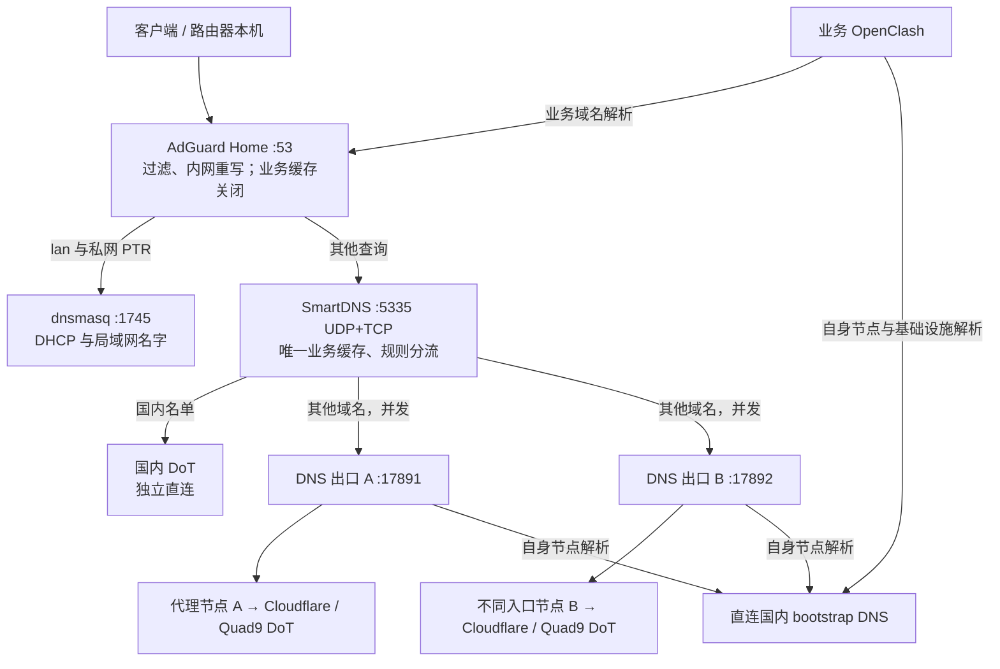

# iStoreOS DNS 架构修复设计

状态：待用户审阅的设计，尚未实施。2026-11-07。

用户要求完整修复方案，并允许架构级调整。本设计据此选择具体路线；新增端口、阈值和预算是设计值，不是线上已有事实。现场证据见 [调查报告](../../router-dns-investigation-2026-11-07.md)。

## 选择与目标

| 路线 | 收益 | 代价 | 结论 |
|---|---|---|---|
| 修整现有组件，并独立 DNS 出口 | 保留 AdGuard 的过滤、SmartDNS 的国内优化及已有例外；消除循环和业务代理重启依赖 | 增加一个小型 Mihomo 实例和有界健康控制器 | 本设计推荐并展开此路线 |
| 将全部解析交给业务 Mihomo | 组件少，分流集中 | 业务代理重启仍影响 DNS；需迁移 SmartDNS 已有优化和例外 | 不采用 |
| 更换为 mosdns 等新解析器 | 更自由地控制请求管道 | 增加新解析器的迁移、版本和规则语义风险；尚无证据表明必须更换 SmartDNS | 暂不采用 |

目标是让 DNS 形成无循环的依赖关系，让一次上游失败不再被额外放大到近一小时，并让业务 OpenClash 重启不影响国内、海外和内网解析。第一期不更改 PVE、Git 传输、DHCP 网关、代理业务分组或全网 IPv6 策略，也不固定 GitHub IP。

这是单路由器上的服务容错，不是跨设备高可用。路由器掉电、WAN 断线、全部代理供应商失效仍会影响网络。

## 目标拓扑

A/B 由一个独立、精简的 Mihomo 进程提供两个 HTTP listener，每个 listener 固定绑定一个 selector。它不开 TUN、不接管透明流量、不改系统路由、不加载业务 geosite/rule-provider，不跟随业务 OpenClash 重启。两个 listener 不是两个进程：该独立进程本身仍是共享故障点，由 procd 管理恢复。

## 职责与配置契约

**AdGuard Home。** 保留 TCP/UDP 53、过滤列表、客户端统计和现有内网重写；设置 `cache_enabled: false`、`cache_optimistic: false`、`fallback_dns: []`。普通公网上游只指 SmartDNS，`lan` 和私网 PTR 明确转 dnsmasq。过滤策略不会因缓存关闭而停用。关闭额外远端 fallback，是为了避免绕过统一分流及重复引入代理依赖；容错在 SmartDNS 的并行上游层完成。

只由新管理器维护 AdGuard 的 DNS 转发和缓存字段；过滤列表、用户、客户端和非 DNS 设置仍由 AdGuard 自己维护。改 YAML 必须停止进程或走其受支持的配置接口，避免运行中的进程退出时覆盖磁盘改动。任何配置快照均留在 router 的受限目录，不复制账号或密码进 Git。

**SmartDNS。** 保留现有程序和 OpenWrt procd 集成，作为唯一业务缓存及分流器。监听 UDP 和 TCP 5335，限 loopback 接口；当前启动脚本支持 `bind_device=1`、`bind_device_name=lo`。新增 loopback 15354 作为 `-no-cache -no-serve-expired` 探测入口，使用相同分流策略。业务入口 `serve_expired=0`，保留 prefetch，TTL 最小值 0、最大值 600 秒，不额外拉长失败 TTL。缓存大小先保持现值，切换前重新读取，不照旧快照复制。

期望失败恢复：上游恢复后 10 秒内，业务入口不再返回先前的缓存 SERVFAIL。必须用当前二进制故障注入实测；不能仅凭上游源码中的失败 TTL 常量宣称通过。NXDOMAIN 和 AAAA 的预期 NODATA 是合法结果，不按 SERVFAIL 处理。

**分流规则。** default 组在本设计中明确等于海外组；国内服务器全部是 `-group china -exclude-default-group`。海外 A/B 上游同时属于 `overseas` 和默认组，不混入国内服务器。这是对旧方案“默认组只放国内”的架构调整，必须同步迁移原来指向 `default` 的国内规则，不能只改某几个 exclude 开关。

规则优先级为：现有内网重写/明确地址例外 → 强制海外例外 → 国内名单 → 海外名单 → 默认海外。先保留已有 GGC 精确域名地址例外及当前 AAAA 抑制行为，单独记录其来源、核验状态和复核时间，不在本次切换中同时删除它们。

编译器输出每个域名的最终规则，避免靠多份配置加载顺序碰运气。强制海外父域下的冲突国内子域必须被过滤，不能让“最长后缀匹配”反过来盖掉强制例外；明确地址例外仍可覆盖这一规则。国内规则输出 `-nameserver china` 和原有测速策略，海外及默认规则关闭直连 IP 测速。默认海外的代价是未被国内名单覆盖的国内域名可能取得海外 CDN 地址，这必须通过国内样本和污染巡检发现并修正名单。

**海外上游。** 配置四条并行路径：A 使用 Cloudflare `1.1.1.1`、Quad9 `9.9.9.9`，B 使用 Cloudflare `1.0.0.1`、Quad9 `149.112.112.112`。使用四个明确地址便于追踪各连接和验证实际分路；同一公共 DNS 的两个地址不算两个供应商。Google DNS 保留为诊断目标，不必在每次业务查询中再增加两条请求。每条路径用正确的 SNI、主机名和 CA 校验证书，禁止 `no-check-certificate`。SmartDNS 使用命名代理 `dns-a`、`dns-b`，分别指向两个 listener，不再使用业务核心的 7893。

SmartDNS 的 UCI 适配器当前 `use_proxy=1` 只会生成 `default-proxy`。因此上游统一由 `/etc/dns-stack/current/upstreams.conf` 生成，UCI 原有 server 项停用，`custom.conf` 只加载管理器的当前版本；不修改 `/etc/init.d/smartdns` 厂商文件。不允许生成配置中同时出现旧海外上游和新上游。

**节点 bootstrap。** 两个 Mihomo 实例都显式配置独立的 `default-nameserver`、`proxy-server-nameserver`，不使用 AdGuard、SmartDNS 或系统的 `127.0.0.1` 解析它们自己的节点。首选经本地 CA 正确验证的国内 DoT；加密 resolver 域名由明确的国内 IP bootstrap，bootstrap 传输本身必须直连。测试覆盖所有实际选用节点域名，而非只测一个域名。普通业务域名仍由 AdGuard/SmartDNS 处理；只有基础设施解析使用该独立路径。

**dnsmasq。** 保持 DHCP、现有租约和 1745 端口，专门处理 `lan` 与私网反查；移除公网 WAN resolver 转发能力，避免成为不透明的公网 fallback。不得把 DHCP DNS 改成 5335 或外部公共 DNS，不依赖客户端“第二 DNS”实现主备。

**端口归属必须脱离插件自动交换。** 现场 AdGuard UCI 的 `redirect=exchange` 在 stop/模式切换时会执行 `rm_port53()`：把 dnsmasq 改回 53，并改写 AdGuard YAML 的端口。最终必须转成插件 `redirect=none`、AdGuard 显式 53、dnsmasq 显式 1745、SmartDNS `auto_set_dnsmasq=0`。迁移时通过 procd 停止实例、绕过交换端口的 stop 钩子，再一次性设置模式和对应 old_redirect/old_port/old_enabled 状态；在旧 exchange 状态未清理前禁止直接 start。用当前插件脚本的行为夹具及影子端口演练证明不会抢占 53，然后才进入维护窗口。

## DNS 出口进程与健康控制

建议预留 loopback HTTP 17891/17892、候选 canary HTTP 17893、bootstrap DNS 17874、控制 API 19096；影子解析器用 15353。canary selector 只用于验证候选，不承接业务查询。实施时检查占用，冲突时停止并更新部署清单，不抢占已有进程端口。所有新增端口均不对 LAN/WAN 开放。控制 API 密钥现场生成，权限 0600，不进状态 JSON 或日志。

独立 Mihomo 使用固定校验摘要的本地二进制副本，不软链到业务 OpenClash 的可变核心。procd 单独管理，关闭自身网络下载、NTP、Geo 数据更新等不需要的启动依赖。沿用现场已验证的核心 GID 出站豁免机制；本次读到业务核心与 `nogroup` 是 GID 65534。部署时必须重新核对 GID、IPv4 nat/mangle 豁免及实际出站，防止独立实例被业务核心再次代理。不得只设 UID、忽略实际 GID。相关规则变化时告警并重新验证，不自动改全网路由。

业务核心未运行、相关拦截链不存在时，独立出口应正常直连启动，不能因为“找不到 OpenClash 豁免规则”反而等待业务核心。链建立后再核对豁免。每份出口配置最多加载八个实际候选，避免把整个业务节点库和资源开销复制过来。

A/B 候选从已有审核池生成，但使用独立 provider 文件，不在运行时直接引用业务排序文件。两条路径的当前节点必须是不同的底层入口：按解析后的入口 IP、端口、协议、必要的传输特征去重，不能只按节点名称区分。优先不同线路/供应商；若供应商相同，状态明确标记为同供应商的降级冗余，不能声称可抵抗供应商整体失效。

首期候选地域由部署策略明确固定：优先日本，其次美国；选择第一个同时具备两条不同入口、且真实 DoT 与 Google/YouTube 回连测试合格的地区。两路优先保持相同地区，避免为了冗余随机跨地域。若无法找到合格双路，维持旧生产配置并报告候选不足；不偷偷以同一节点充当 A/B，也不以香港节点补位。这个地域顺序是本方案建议，不是用户已指定的偏好。

健康控制器用真实 HTTP CONNECT → TLS → DNS wire 查询，不能用 gstatic HTTPS 状态代替。每 15 秒一轮，两路并行，每路对两个 resolver 检查，单目标截止时间 3 秒。期望域名 A 返回 `NOERROR` 且至少一个有效 A；`.invalid` 负向样本预期 NXDOMAIN。校验事务 ID、问题段、RCODE、记录类型、证书及完整报文，截断或半包不能记成功。

单路连续三轮两个 resolver 都失败时尝试替换该路节点；另一条健康路径仍并发接业务请求，因此业务不需要等健康控制器才使用 B。切换前验证候选，单次只更新一路；最少驻留 120 秒，稳定后不因轻微测速差异主动切回。两路都失败时告警并有限轮询，保留最后有效配置，不循环重启 AdGuard/SmartDNS，不把 SERVFAIL 伪造成 NXDOMAIN，不静默把海外查询降级到国内 DNS。

候选先在独立 canary selector 上完成验证，不能为测试候选直接切换业务 A/B。计划更新要求另一条路径健康；双路故障恢复则允许把已由 canary 验证的候选先提升为 A，恢复一条后再处理 B，不能因“必须先有一路健康”的保护条件永远无法自救。跨地域恢复前仍需通过该地域的回连验证，并将实际地域写入状态。

健康状态保存在 `/tmp/dns-stack/state.json`：时间、代次、每路匿名节点标识、失败域、最后成功、连续失败、探测耗时及错误类型。状态中不含节点凭据。控制器重启或状态损坏时，从当前 selector 状态恢复并重新验证，不清空仍能工作的节点。

## 单一配置来源与自动任务

非密钥策略以仓库 `deploy/router-dns/policy.json` 为唯一来源，部署到 `/etc/dns-stack/policy.json`。节点原始凭据只在 router 读取和生成。生成版本位于 `/etc/dns-stack/releases/<generation>/`，`current` 指向完整、已校验的版本；保留前两版及迁移前快照。每份版本有非密钥 manifest，记录版本、来源摘要、规则数量、上游关系和验证结论。

所有配置在同一部署锁下生成；启动配置中的 include 使用固定代次的绝对路径，不在解析多个文件时反复追踪可变的 current 链接。这样一次指针切换不会把旧国内规则与新海外上游拼在一起。运行时 YAML 由 Ruby 正规解析；新增依赖仅为与现场 Ruby 兼容的 `ruby-json` 桥接包。若包源/版本不兼容，停止在依赖预检，不升级整个 Ruby 或手写 YAML 解析器绕过。

| 对象 | 唯一写入者 | 必须调整的旧行为 |
|---|---|---|
| AdGuard DNS 参数 | dns-stack 管理器 | 保留 UI 对过滤和客户端设置的管理；发现 DNS 参数漂移告警 |
| SmartDNS UCI 基础项、custom.conf、编译规则 | dns-stack 管理器 | 禁止另一个脚本直接生成或替换同一规则集 |
| 业务 OpenClash 节点 DNS 设置 | 现有 custom overwrite 的指定区块 | 删除“日志称关闭、实际启用并指回 127.0.0.1”的矛盾逻辑；保留 nginx 设置同步区块 |
| DNS 出口 provider 与 selector | dns-stack 同步器、健康控制器，经同一锁串行 | node_audit 不得直接改它们；更新候选不代表必须换当前节点 |
| 规则更新 | `/usr/sbin/smartdns-auto-rules.sh` 改为调用统一更新入口 | 不再分别 mv 两份文件后仅凭 PID 判成功 |
| 监测 | 新健康控制器及原国内污染巡检 | 污染巡检只报告，不再自动重启 SmartDNS |

`node_audit.py` 保留业务节点测量与排序，但 DNS 候选同步必须在其业务重启逻辑之外安全提交。业务组区域变化仍可能重启业务核心；新 DNS 不依赖它。现有每日 `dns_probe.py` 作为离线深测保留，不与在线控制器争 selector。03:00 的业务 OpenClash 定时重启在本次迁移中保留，以此验证 DNS 隔离是否真实成立。

规则更新采用：下载并校验 TLS → 语法/关键域/相对规模检查 → 整体编译 → 影子查询 → 发布完整代次 → 必要的 SmartDNS reload → 查询验证。当前 SmartDNS `reload_service()` 实际 stop/start，不能承诺零中断；无内容变化不 reload，规则更新放维护窗口，失败恢复上一代并重新查询验收。

## 实施阶段与回滚

1. **建立快照及基线。** 记录端口、GID、服务状态、规则、自动任务、配置哈希，保存 router 本地受限回滚包。首次重启 SmartDNS 前必须确认其 `auto_set_dnsmasq` 和旧联动状态均已解除；如现场不是 0，先单独事务解除并验证 53/1745 归属，不等待最终切换才处理。将“完全回原状”与“仅回退架构、保留关闭失败缓存”分开命名。回滚不回写旧租约或统计数据库。
2. **先移除已确认的放大机制。** 关闭 AdGuard 缓存和 optimistic；暂时继续转现有 SmartDNS，暂留现有 fallback。只变更缓存字段，通过 procd 停止/启动该实例而不触发插件交换端口钩子，检查过滤和内网重写及两端实际端口。此阶段可独立交付，但不等于完整修复。
3. **旁路建立 DNS 出口与影子解析。** 不接管 53，先建立独立双出口、bootstrap、影子 SmartDNS，验证新规则、证书、内网例外和真实业务。生产 DHCP 和生产转发不动。
4. **切换生产 SmartDNS。** 在维护窗口安装新 UCI/custom 配置，短暂重启 SmartDNS，仍占 5335；验收成功后移除 AdGuard 远端 fallback，明确 lan/PTR 转发，再处理 dnsmasq 的公网 fallback。每个子步骤独立验证，失败回退其上一个状态。
5. **统一自动任务。** 接入受控规则更新、候选同步、在线探测；完成持锁、漂移检测和规则完整性检查后，旧自动写入入口才退出。业务 custom overwrite 改 bootstrap 时必须核对 nginx 同步功能保留。
6. **故障演练与持续观察。** 先在影子环境注入单路故障、双路故障、坏更新、控制器崩溃；生产仅做单路且可即时撤销的演练。观察至少覆盖一个每日业务重启、一个候选更新和一个规则更新周期的受控演练。连续观察 72 小时后收尾。

切换前安排持久回滚看门狗：应用步骤限时 180 秒，只有 router 本机及一台 LAN 客户端验证通过后才显式确认；未确认自动恢复该步骤的快照。它不依赖 SSH 会话、业务 DNS 或业务 OpenClash 存活。任何未恢复的步骤都不继续推进后续变更。

看门狗使用独立、固定版本的恢复入口和本地事务日志，不依赖正被切换的 current、健康控制器或新 YAML 桥接包；恢复时按快照的服务模式和端口重新拉起，不能用插件 stop/start 再次把恢复后的端口交换掉。

生产单路演练前，必须已验证另一条路径健康；不得为验收同时断掉两条生产路径或全屋 WAN。整机冷启动验收安排在单独的维护窗口，未执行则如实留为未验收项，不以“procd 配好了”代替。

## 验收标准与限制

| 场景 | 验收目标 |
|---|---|
| 原问题复现 | 模拟上游 SERVFAIL 后恢复；AdGuard 不保存额外失败缓存，10 秒内恢复正确 A |
| 单路出口/单个公共 resolver 失效 | 在影子入口进行 1000 次、最多 10 QPS 的冷/热混合查询，SERVFAIL 为 0，单次总耗时不超过 3 秒 |
| 两路都失效 | 返回真实 SERVFAIL，无假 NXDOMAIN；全请求 5 秒内结束；上游恢复后 10 秒内恢复 |
| 业务 OpenClash stop/start | 影子连续查询不失败；生产维护窗口验证国内、海外、内网 DNS 均不依赖其存活 |
| 启动时业务 DNS 不可用 | 独立出口仍能直接解析节点并启动；不能依赖缓存中的旧节点 IP 才成功 |
| UDP/TCP 与大回复 | 两种传输均可用；TC=1 时的 TCP 重试正常，禁止只有小 A 查询通过就算完成 |
| 分流与现有功能 | 国内样本不被送到海外 DNS；未知域默认海外；过滤、内网、GGC 例外和现有 AAAA 策略均符合预期 |
| 失效更新 | 部分下载、畸形 YAML、空候选、错误证书、锁冲突均不能覆盖当前有效代次或移除当前健康节点 |
| 回滚 | 主动阻断远程会话后，看门狗仍能恢复上一步；状态和租约不被旧快照覆盖 |
| 资源与观察 | 新增常驻组件合计 RSS 预算不超过 96 MiB；72 小时内无持续增长、切换抖动或同一失败缓存延长现象 |

1000 次和时间阈值均是上线门槛，不是已经测得的性能保证。出现不符合时停止切换，记录具体瓶颈后调整方案，不能降低判据后声称原方案通过。整机/WAN/供应商共因故障不在两路节点冗余可消除的范围。

日志保留最近 72 小时的有界健康事件和配置代次，详细抓取只在故障窗内启用；不得记录完整节点配置、控制密钥或全量用户查询。NAS 不可写时继续使用有限本地环形日志，解析主路径不能等待 NAS。

## 参考与现场依据

- 当前路由器 `/etc/openclash/custom/openclash_custom_overwrite.sh` 会把 DNS 启用并强制指回 127.0.0.1，同时打印相反日志；修复必须保留该文件后半段 nginx 设置同步。
- `/etc/init.d/smartdns` 已核实支持 loopback 设备绑定、TCP、额外参数；其 reload 是 stop/start。UCI 生成文件不是配置源。
- 2026-11-07 19:03 读取 `/proc/meminfo`：MemTotal 3497248 kB，MemAvailable 约 2.5 GiB；不能继续用旧文档“路由器 2GB”判断余量。新增组件实际 RSS 仍需影子测量。
- [Mihomo listener 的 proxy 字段](https://wiki.metacubex.one/config/inbound/listeners/#proxy) 支持入口绑定策略组；[节点独立解析配置](https://wiki.metacubex.one/config/dns/#proxy-server-nameserver) 用于切断 bootstrap 依赖。必须再用当前固定二进制校验实际配置。
- [SmartDNS 配置](https://pymumu.github.io/smartdns/configuration/) 提供命名代理、组、排除默认组和 no-cache 探测入口。国内/海外组的最终关系以编译产物和影子流量验证。
- 四个公共 resolver 地址及 TLS 参数按 [Cloudflare DoT 文档](https://developers.cloudflare.com/1.1.1.1/encryption/dns-over-tls/) 和 [Quad9 服务说明](https://docs.quad9.net/services/) 核对；实施时必须再以所选节点实测，不把官网支持等同于当前出口可达。
