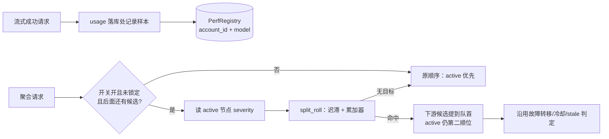

# 聚合别名性能自适应分流（Spill Valve）设计

日期：2026-11-27。本文描述已落地的实现；判据以代码和测试为准，数字不是生产实测快照。

## 目标与已确认决策

聚合别名平时把 100% 请求交给 `active` 候选。仅当 `active` **相对自身历史基线**明显变慢时，
才把一部分新请求交给它后面的候选，用下游更快的节点吸收突发；恢复后自动收回。

1. **恶化才分流**：健康时 100% 走主候选。不改变 `active` 指针、3-confirm 升降级、探活与冷却语义。
2. **逐别名开关 + 比例上限**：默认关闭；最大分流比例可配置并夹在 0–90%（至少给主候选留 10%
   流量，让它的基线继续更新、恢复能被看见）。生产上给 sonnet 别名开启属于手工配置动作，
   不在代码里硬编码，也不随部署自动生效。
3. **不做采样**：没有"平时也分流 1%"的常开探针；没有可信基线就不分流。
4. **只用流式成功请求**：样本是真实 TTFT 与解码 `tokens/s`。非流式路径的 `ttft_ms` 等于
   总耗时，与流式不可比，不进基线。

## 数据流

## 配置

- 迁移 `crates/llmux-core/src/migrations/0038_aggregate_adaptive_split.sql`：
  `adaptive_split INTEGER NOT NULL DEFAULT 0`、`adaptive_max_spill_pct INTEGER NOT NULL DEFAULT 50`。
  本仓没有迁移记录表，每次启动重跑全部迁移并吞掉 duplicate column；**不要改历史迁移**。
- 保存路由 `routes/models/aggregate.rs`：`adaptive_split` 取布尔（缺省 false），
  `adaptive_max_spill_pct` 取整数（缺省 50）后 `clamp(0, 90)`；0 表示"开着开关但不分流"
  （UI 滑块最小 10，不会随手设出 0）。更新时字段缺省 = 显式关闭，避免老客户端的 PUT
  把旧值悄悄留在库里。列表/详情回读这两个字段。
- UI `ui/src/routes/models.tsx`：聚合编辑器里的「性能自适应分流」勾选框 + 最大分流比例滑块
  （10–90%，步长 5）。保存时随聚合配置一起发送；编辑时回显库中值，新建时默认关 / 50%。

## 性能基线与恶化判定

`crates/llmux-core/src/perf.rs` 是纯内存、进程级的 `PerfRegistry`，键为 `(account_id, model)`，
重启清零。每条流式成功样本按当前时间更新四条**时间衰减 EWMA**：

| 指标 | fast 半衰期 | slow 半衰期 | 含义 |
|---|---|---|---|
| TTFT | 30s | 2h | 最近出首字节有多慢 / 平时有多快 |
| tokens/s | 30s | 2h | 最近解码有多慢 / 平时有多快 |

`severity = max(fast_ttft / slow_ttft, slow_tps / fast_tps)`，另设绝对差下限
（TTFT ≥ 250ms、tokens/s ≥ 2）压掉小基数噪声。冷启动、样本不足 3 条、最近 600s 没样本、
非有限值一律返回 1.0（健康）。注册表最多 4096 个节点、一小时没更新的节点被清掉。

样本入口在 `routes/v1/helpers.rs::spawn_log_usage_ip`：只有 `success && is_stream` 且有
`ttft_ms` 时记录；tokens/s 只有在解码耗时 ≥ 500ms 且输出 token ≥ 8 时才算，否则只记 TTFT。
失败请求和非流式请求不写基线。

## 分流调度

在 `routes/v1/openai.rs::dispatch_aggregate_with_conversion`（Chat / Responses / Messages
三种入口共用）里，构造候选访问顺序之前：

- 条件：`agg.adaptive_split && !agg.locked && active + 1 < len`。锁定别名完全不参与。
- 取 `agg.candidates[active]` 的 `(account_id, model)` 在注册表里的 `severity`。
- `AggregateRouter::split_roll` 做决策：
  - 迟滞：`severity ≥ 1.8` 进入分流，`≤ 1.3` 退出；中间保持原状态，避免阈值附近抖动。
  - 目标只在 `active+1 .. len` 里找，且跳过来源已失效（`stale_source`）和最近确认失败
    （`last_status == Some(false)`）的节点；不会把流量给已被降级的更靠前候选。
  - 比例 `p = max_spill × clamp((severity - 1.3) / (3.0 - 1.3), 0, 1)`；小数累加器
    每满 1 才分一次，避免取整把 10% 变成 0%。
  - 命中时把目标插到访问顺序**队首**，原 `active` 仍在第二顺位：目标失败照常回主候选。
- 状态迁移隔离：分流请求没有尝试锚点，`anchor_attempted = false`，所以成功落在下游也
  **不会**推进降级/回升确认；只有锚点被真的试过且失败才算证据。`active` / `locked`
  完全由原有升降级与锁定逻辑管理。

## 恢复与回切

主候选持续拿到至少 `1 - max_spill ≥ 10%` 的流量，基线因此持续更新。它恢复后 `fast` 在
~30s 尺度回落，severity 跌到 1.3 以下时 `degraded` 被清掉、累加器归零，下一次请求起
100% 回到主候选。日志会打 `✅ [agg:X] 主候选性能恢复 … → 停止性能分流`。
无样本 / 超过 600s 没样本同样按健康处理：下一次 `split_roll` 会用 severity=1.0 清掉
锁存；开关关闭或锁定期间不调用它，但重新打开后的第一次调用同样先清锁存，所以不会
带着旧状态误分流。失败标记过的下游候选不是永久黑名单——真实流量成功和探活成功都会
把它写回可用（`note_candidate_success` / `record_probe_candidate`）。

## 边界与代价

- 只对**恶化幅度**反应，不判断下游是否真的更快；下游节点自身也进注册表，只是不作为本别名的判据。
- 分流是按别名的、单进程内的软调度；重启后迟滞状态和基线都清零。
- 长时间严重恶化时下游可能成为事实主力，但 `active` 不变，硬失败导致的升降级路径也不变。
- 不写库、不新增定时器、不对外发请求；热路径只有一次 `HashMap` 查找和短暂加锁。

## 可观测性

- `⚠️ [agg:X] 检测到主候选性能恶化 sev=… → 开始性能分流（上限 …%）` / `✅ … 恢复 …` 为 INFO。
- `🔀 [agg:X] 性能分流 → 候选 i (model) | sev=…` 为 DEBUG，和现有派发行 `🔀 [agg:X V=m]` 并列；
  二者不冲突：前者说"这次先试谁"，后者说"内存里 active 是谁"。

## 验证

- `crates/llmux-core/src/perf.rs` 单元测试：冷启动 / 样本不足 / 过期 / TTFT 与 tps 两个方向 /
  绝对差下限 / 注册表裁剪。
- `crates/llmux-core/src/aggregate.rs` 单元测试：只往后选目标、累加器比例、迟滞、跳过坏目标、
  比例夹紧、非有限值安全。
- `crates/llmux-core/tests/core_contract.rs::migration_0038_adds_adaptive_split_columns`：
  列默认值与重启幂等。
- `crates/llmux-server/tests/adaptive_split_contract.rs`：配置回读与 90% 上限、关闭/健康时不分流、
  注入恶化基线后实际分流且不改 `active`、恢复后回切、样本入口只收流式成功请求。
